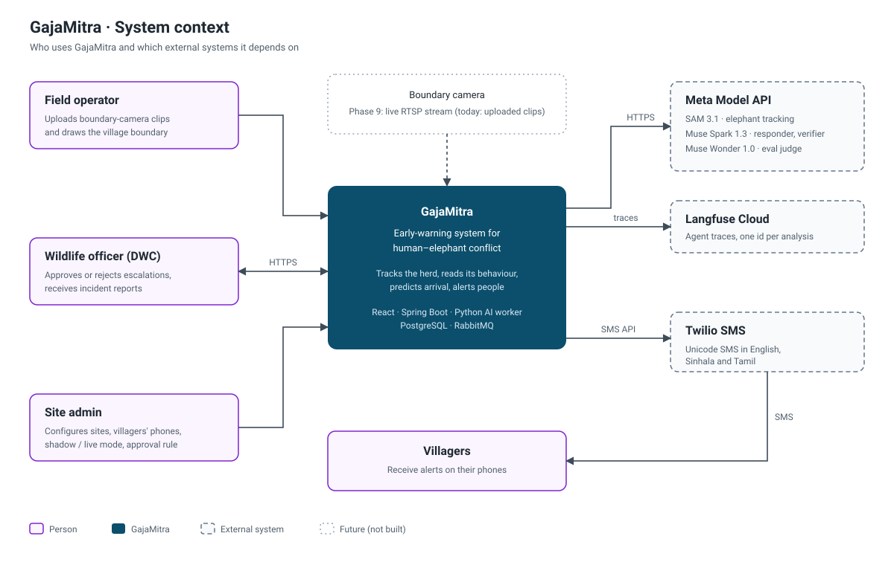
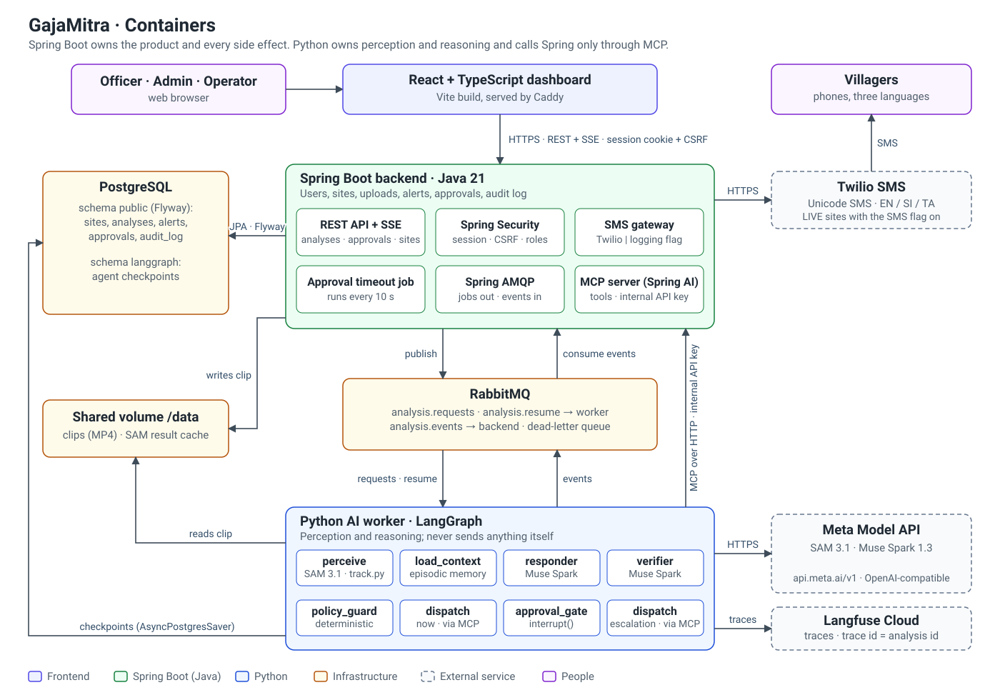
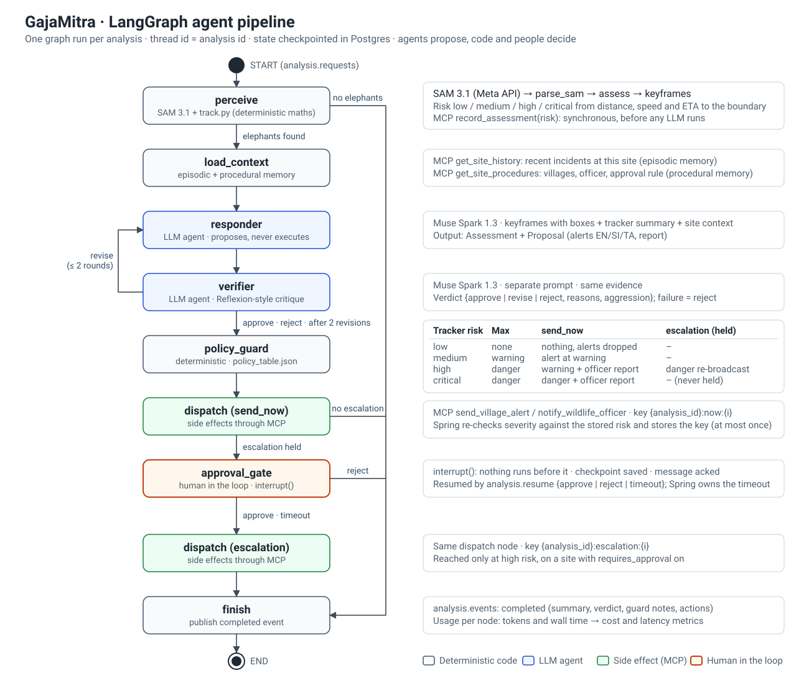
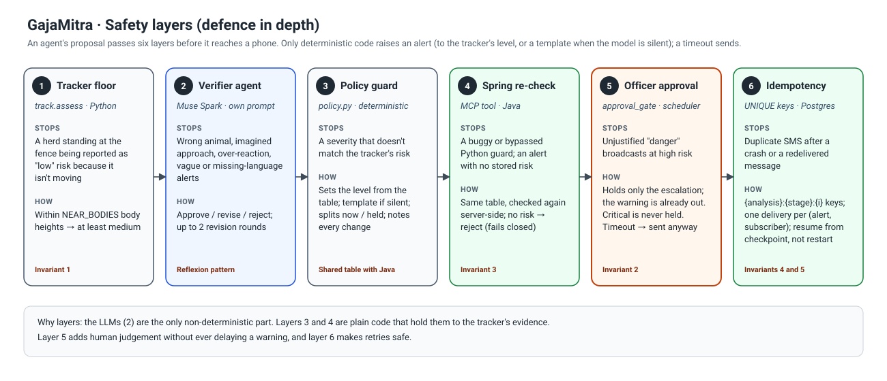
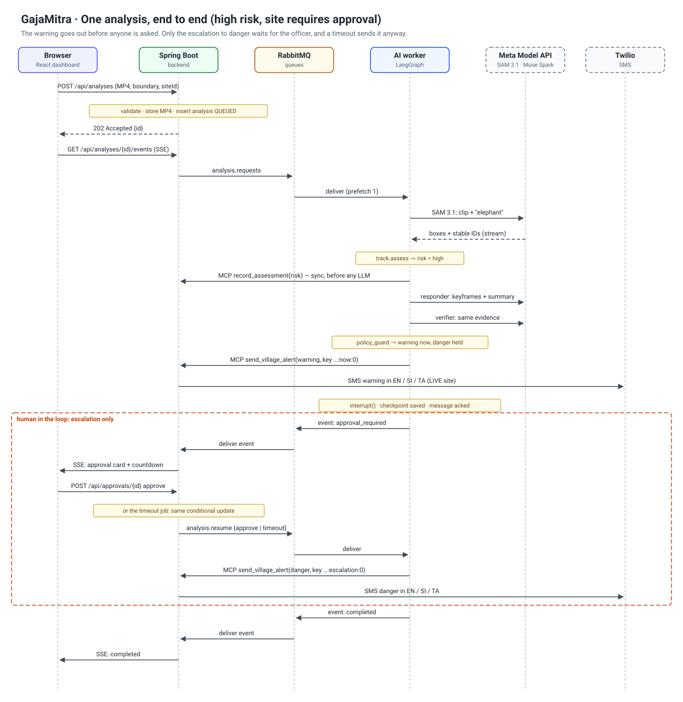
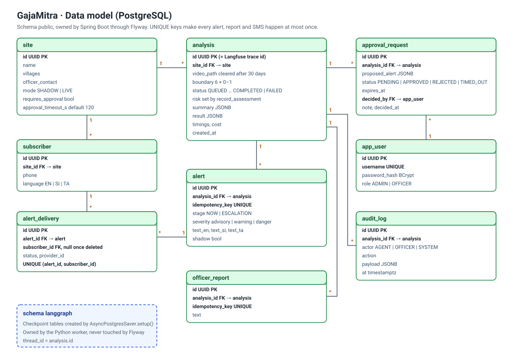
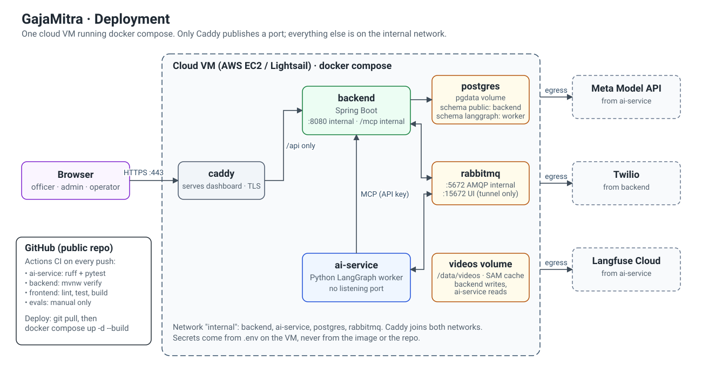

# GajaMitra

**An early-warning agent for human–elephant conflict, built on Meta's models.**

Every year in Sri Lanka, hundreds of elephants and more than a hundred people die in human–elephant conflict, mostly at night on the edges of villages. Existing systems are detectors trained for one site, and they stop at "elephant detected". GajaMitra goes further: it tracks the herd, reads its behaviour, predicts when it will reach the village, and decides what to do about it.

> Built from scratch during the Meta Global AI Developer Hackathon (Nov 3–5, 2026). Everything in this repository was written during the event.

## How it works

```
boundary-camera clip
      │
      ▼
SAM 3.1 (Meta Model API) ── "elephant" ──► per-frame boxes with IDs that stay the same across frames
      │
      ▼
track.py ── where each elephant touches the ground, velocity, distance to the village boundary, ETA, risk level
      │
      ▼
Muse Spark 1.3 (vision, JSON output)
  • reads behaviour from keyframes: calm / alert / warning / aggressive / conflict-risk, calves
  • proposes alerts (English, Sinhala, Tamil) and an officer report; it sends nothing itself
      │
      ▼
policy.py (deterministic guard) ── sets the alert level from the tracker risk, fills in a template if the
                                   model is silent or invalid, adds the officer report, records every change
      │
      ▼
dashboard ── live boxes, trails, predicted paths, risk level, what the guard decided and why
```

| Meta model | What it does here |
|---|---|
| SAM 3.1 | Tracks each elephant across the clip from a text prompt. IDs stay the same, so no separate tracker is needed |
| Muse Spark 1.3 | Classifies behaviour from video frames and proposes the response and the alerts in three languages; a deterministic guard decides what is sent |

## Architecture

The target system is a Spring Boot backend, a Python LangGraph worker (responder and verifier agents, a deterministic guard, officer approval) and a React dashboard. Design decisions and trade-offs: [docs/ARCHITECTURE.md](docs/ARCHITECTURE.md). Build phases: [docs/IMPLEMENTATION_PLAN.md](docs/IMPLEMENTATION_PLAN.md).

### System context
Who uses GajaMitra and which external systems it depends on.



### Containers
Spring Boot owns the product and every side effect. The Python worker owns perception and reasoning, and calls Spring only through MCP tools.



### Agent pipeline
The agents only propose. A deterministic guard sets their proposal to the level the tracker's evidence allows, and a wildlife officer approves escalations.



### Safety layers
Six checks sit between an agent's proposal and a villager's phone.



<details>
<summary><b>More diagrams:</b> one analysis end to end, data model, deployment</summary>

#### One analysis, end to end
The warning goes out before anyone is asked. Only the escalation to "danger" waits for the officer, and a timeout sends it anyway.



#### Data model
UNIQUE idempotency keys make every alert, officer report and SMS happen at most once.



#### Deployment
One VM running docker compose. Only Caddy publishes a port.



</details>

## Repository layout

| Path | What |
|---|---|
| `ai-service/` | Python 3.11 package `gajamitra`: SAM 3.1 perception, tracking maths, agents. Also holds the working prototype web app until Spring Boot and React replace it |
| `backend/` | Spring Boot 4.1, Java 21 (skeleton) |
| `frontend/` | React + TypeScript, Vite (skeleton) |
| `policy/policy_table.json` | Alert guardrail table shared by Python and Java |
| `docker-compose.yml` | Local PostgreSQL and RabbitMQ |
| `docs/` | Architecture, implementation plan, `development/` (Claude Code toolkit guide and quick start) |
| `CLAUDE.md`, `.claude/` | Engineering handbook, path rules, skills, review agents and the guard hook used with Claude Code |
| `.github/workflows/` | CI, PR checks (commit messages, PR title) and semantic-release |
| `package.json`, `.releaserc.json`, `commitlint.config.mjs` | Release and commit-message tooling (not an application) |

## Contributing

Branch per task (`<type>/GM-<n>-<slug>`), commit as `<type>: <message>` (`feat`, `fix`, `perf`, `refactor`, `docs`, `style`, `test`, `build`, `ci`, `chore`, `revert`), and title PRs `<type>: <message> - GM-<n>`. PRs are squash-merged; releases, tags and `CHANGELOG.md` are produced automatically by semantic-release. Details: [docs/development/CLAUDE_CODE_TOOLKIT.md](docs/development/CLAUDE_CODE_TOOLKIT.md).

## Run the prototype

```powershell
python -m venv .venv
.venv\Scripts\activate
pip install -e "ai-service[dev]"
$env:MODEL_API_KEY = "LLM|..."          # from your Meta Model API dashboard
cd ai-service
uvicorn gajamitra.app:app --reload
```

Open http://127.0.0.1:8000. Upload an MP4, click **Set village boundary** (two points on the boundary line, then one point on the village side), and press **Analyze**.

## Checks

| Part | Command (run inside the folder) |
|---|---|
| ai-service | `ruff check .` and `pytest` (tracking maths, no API calls) |
| backend | `.\mvnw verify` |
| frontend | `npm ci`, `npm run lint`, `npm run build` |
| infrastructure | copy `.env.example` to `.env`, set the passwords, `docker compose up -d` |

GitHub Actions runs the first three on every push.

## Research angle

Published Sri Lankan systems (UoM 2020, SLIIT 2023, Peradeniya 2024, SEUSL 2025) train their own detectors on local data. A 2026 study (Varma et al., ISSF) classifies elephant behaviour with YOLOv8 + LSTM and notes that few studies address behaviour recognition for conflict prevention. GajaMitra asks whether **foundation models with no training at all** can track elephants, recognise their behaviour and give enough warning. It measures detection recall, minutes of warning before arrival, and false alarms per night.

## Known limits

- Risk thresholds in `track.py` (`HIGH_ETA_S`, `MIN_CLOSING_PX_S`) are tuned for short demo clips. Real herds move slowly, so raise them for real deployments.
- A herd standing within `NEAR_BODIES` body heights of the boundary counts as medium risk even if it isn't moving. Body height is the height of the elephant's box, so this works at any resolution and roughly at any distance from the camera.
- Distances are in image pixels. ETA doesn't depend on scale, but it assumes the herd keeps moving at the same velocity.
- Alerts are shown on the dashboard only. An SMS or voice gateway is the next step.
