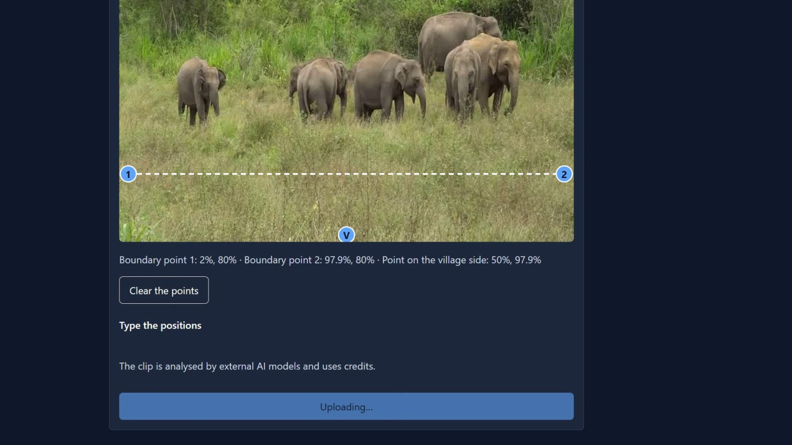
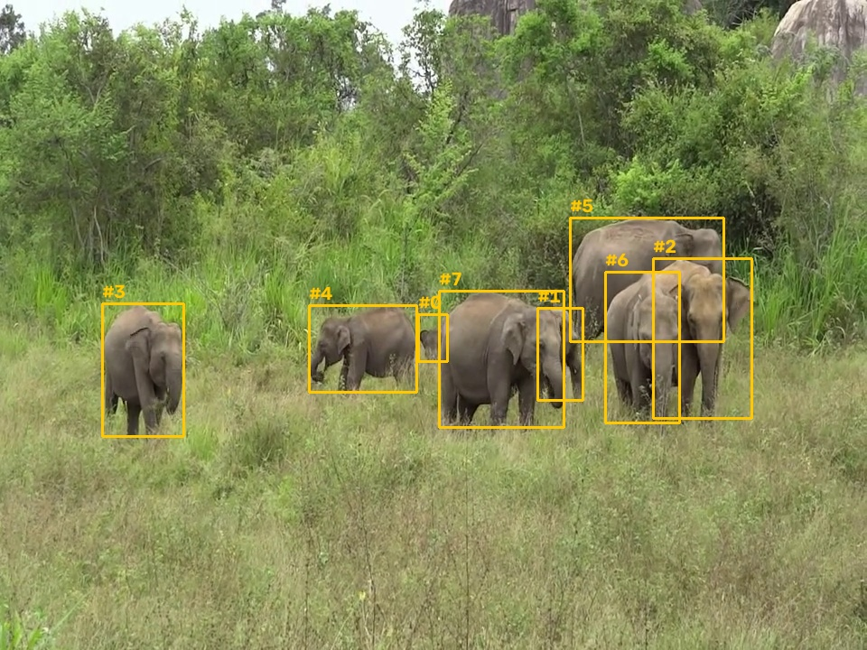
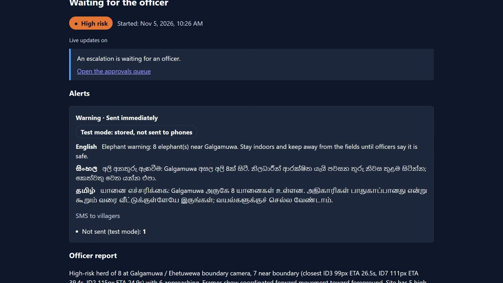
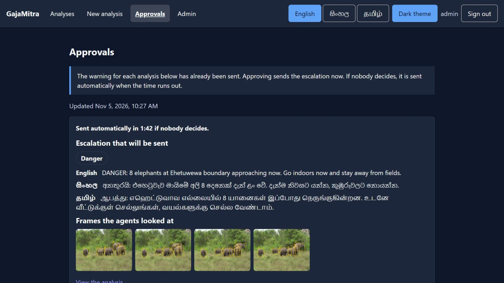
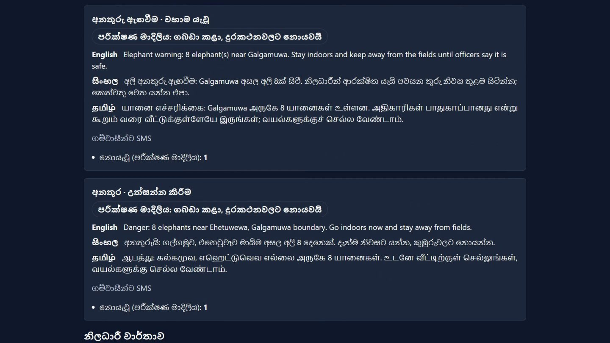
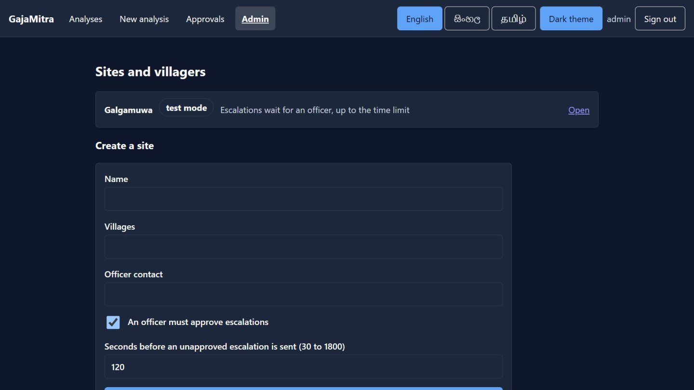
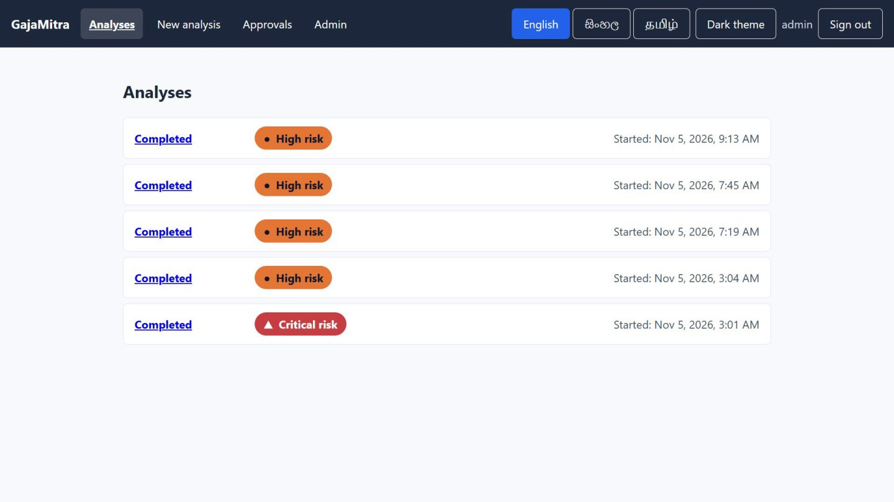

# GajaMitra

**An early-warning agent for human–elephant conflict, built on Meta's models.**

Every year in Sri Lanka, hundreds of elephants and more than a hundred people die in human–elephant conflict, mostly at night on the edges of villages. Existing systems are detectors trained for one site, and they stop at "elephant detected". GajaMitra goes further: it tracks the herd, reads its behaviour, predicts when it will reach the village, and decides what to do about it.

> Built from scratch during the Meta Global AI Developer Hackathon (Nov 3–5, 2026). Everything in this repository was written during the event.

## How it works

1. **Track.** SAM 3.1 finds every elephant in the boundary-camera clip and keeps one ID per animal. `track.py` turns the boxes into distance to the village boundary, speed, arrival time and a risk level.
2. **Read.** Muse Spark 1.3 looks at keyframes, judges behaviour (calm, alert, aggressive, calves) and proposes alerts in English, Sinhala and Tamil. It sends nothing itself.
3. **Check.** A deterministic guard (`policy.py`, re-checked by Spring) sets the alert level from the tracker's risk, never from the model.
4. **Warn.** The warning goes to villagers by SMS at once. Only an escalation to "danger" waits for a wildlife officer, and a timeout sends it anyway.

| Meta model | Role |
|---|---|
| SAM 3.1 | Tracks each elephant from a text prompt, with stable IDs |
| Muse Spark 1.3 | Reads behaviour, proposes the alerts, reviews them, and judges alert quality in the evals |

## The dashboard

Screenshots from a real run of the app (the demo site is in test mode, so alerts are stored and no SMS is sent).

| | |
|---|---|
|  |  |
| **New analysis.** Choose a site, upload a clip, click two points on the boundary and one on the village side. | **Tracking.** SAM 3.1 boxes every elephant and keeps its ID across frames. |
|  |  |
| **Result.** Risk level, the warning in three languages, and the officer report with distance and arrival time. | **Approvals.** The warning has already gone out; the escalation waits for an officer and is sent automatically when time runs out. |
|  |  |
| **Three languages.** The whole interface switches to Sinhala or Tamil. | **Admin.** Sites, villagers, test or live mode and the approval time limit. |

**Light and dark themes.** The screens above use the dark theme; this is the analyses list in the light theme.



## Architecture

Spring Boot owns all data and every side effect. A Python LangGraph worker owns perception and reasoning and reaches Spring only through MCP tools and RabbitMQ. More diagrams, the data model and design decisions are in [docs/ARCHITECTURE.md](docs/ARCHITECTURE.md); the build plan is [docs/IMPLEMENTATION_PLAN.md](docs/IMPLEMENTATION_PLAN.md).


Also: [system context](docs/architecture/01-system-context.svg), [one analysis end to end](docs/architecture/04-analysis-sequence.svg), [data model](docs/architecture/05-data-model.svg), [deployment](docs/architecture/06-deployment.svg).

## Repository layout

| Path | What |
|---|---|
| `ai-service/` | Python 3.11 package `gajamitra`: SAM 3.1 perception, tracking maths, agents. Also holds the working prototype web app until Spring Boot and React replace it |
| `backend/` | Spring Boot 4.1, Java 21: users, sites, uploads, alerts, approvals, SMS, audit log, MCP server, evidence frames |
| `frontend/` | React + TypeScript, Vite: officer dashboard (analyses, live page, approvals, new analysis, admin), English / Sinhala / Tamil |
| `deploy/` | Caddy web door: serves the dashboard, forwards `/api`, never forwards `/mcp` |
| `evals/` | Labelled eval cases, runner and footage sources (`footage.md`); the clips themselves are not in git |
| `policy/policy_table.json` | Alert guardrail table shared by Python and Java |
| `docker-compose.yml` | The whole stack: PostgreSQL, RabbitMQ, backend, worker, web (Caddy) |
| `docs/` | Architecture, implementation plan, `development/` (Claude Code toolkit guide and quick start) |
| `CLAUDE.md`, `.claude/` | Engineering handbook, path rules, skills, review agents and the guard hook used with Claude Code |
| `.github/workflows/` | CI, PR checks (commit messages, PR title) and semantic-release |
| `package.json`, `.releaserc.json`, `commitlint.config.mjs` | Release and commit-message tooling (not an application) |

## Contributing

Branch per task (`<type>/GM-<n>-<slug>`), commit as `<type>: <message>` (`feat`, `fix`, `perf`, `refactor`, `docs`, `style`, `test`, `build`, `ci`, `chore`, `revert`), and title PRs `<type>: <message> - GM-<n>`. PRs are squash-merged; releases, tags and `CHANGELOG.md` are produced automatically by semantic-release. Details: [docs/development/CLAUDE_CODE_TOOLKIT.md](docs/development/CLAUDE_CODE_TOOLKIT.md).

## Run the prototype

```powershell
python -m venv .venv
.venv\Scripts\activate
pip install -e "ai-service[dev]"
$env:MODEL_API_KEY = "LLM|..."          # from your Meta Model API dashboard
cd ai-service
uvicorn gajamitra.app:app --reload
```

Open http://127.0.0.1:8000. Upload an MP4, click **Set village boundary** (two points on the boundary line, then one point on the village side), and press **Analyze**.

## Run the full stack

```powershell
copy .env.example .env          # then set POSTGRES_PASSWORD, RABBITMQ_DEFAULT_PASS, MCP_API_KEY,
                                # GAJAMITRA_ADMIN_USERNAME / _PASSWORD (12+ chars), MODEL_API_KEY;
                                # GAJAMITRA_SECURE_COOKIES=false when using plain http://127.0.0.1
docker compose up -d --build    # postgres, rabbitmq, backend, worker, web: open https://localhost (local certificate)
                                # for a public host set SITE_ADDRESS=your.host.name (and WEB_BIND=0.0.0.0)
```

Log in with `POST /api/login` (form fields `username`, `password`; send the `XSRF-TOKEN` cookie back as the
`X-XSRF-TOKEN` header on every write), create a site and villagers under `/api/sites`, and upload a clip to
`POST /api/analyses`. New sites are in SHADOW mode: alerts are stored and logged, no SMS is sent.
Analysing a clip calls the Meta API and spends credits.

## Checks

| Part | Command (run inside the folder) |
|---|---|
| ai-service | `ruff check .` and `pytest` (tracking maths, no API calls) |
| backend | `.\mvnw verify` |
| frontend | `npm ci`, `npm run lint`, `npm test`, `npm run build` |
| infrastructure | copy `.env.example` to `.env`, set the passwords, `docker compose up -d` |

GitHub Actions runs the first three on every push.

## Evaluation

`evals/cases.json` holds 16 labelled cases; `python evals/run.py --yes-spend-credits` runs the ones with footage against the real
Meta API (it costs credits) with stub tools, so nothing is sent. It reports counts and an AI-judge score for alert quality.

| Run | Result |
|---|---|
| Latest (13 of 16 cases have footage) | 13/13 pass |

**Read this honestly.** 13/13 is not an accuracy figure. After the first run scored 6/13 I read the tracker rules and relabelled
seven cases, because my labels and boundaries were wrong, not the tracker (a close-up elephant is at least `medium` by design; a
boundary that puts the herd on the village side is `critical`). Only the two Hurulu labels are observed results. Still missing: herds
outside the line and walking toward it, distant calm elephants (false-alarm test), a tabletop-toy clip, and labels set by someone who
knows the scene. Sources and licences: [evals/footage.md](evals/footage.md).

## Research angle

Published Sri Lankan systems (UoM 2020, SLIIT 2023, Peradeniya 2024, SEUSL 2025) train their own detectors on local data. A 2026 study (Varma et al., ISSF) classifies elephant behaviour with YOLOv8 + LSTM and notes that few studies address behaviour recognition for conflict prevention. GajaMitra asks whether **foundation models with no training at all** can track elephants, recognise their behaviour and give enough warning. It measures detection recall, minutes of warning before arrival, and false alarms per night.

## Known limits

- Risk thresholds in `track.py` (`HIGH_ETA_S`, `MIN_CLOSING_PX_S`) are tuned for short demo clips. Real herds move slowly, so raise them for real deployments.
- A herd standing within `NEAR_BODIES` body heights of the boundary counts as medium risk even if it isn't moving. Body height is the height of the elephant's box, so this works at any resolution and roughly at any distance from the camera.
- Distances are in image pixels. ETA doesn't depend on scale, but it assumes the herd keeps moving at the same velocity.
- Alerts are shown on the dashboard only. An SMS or voice gateway is the next step.
