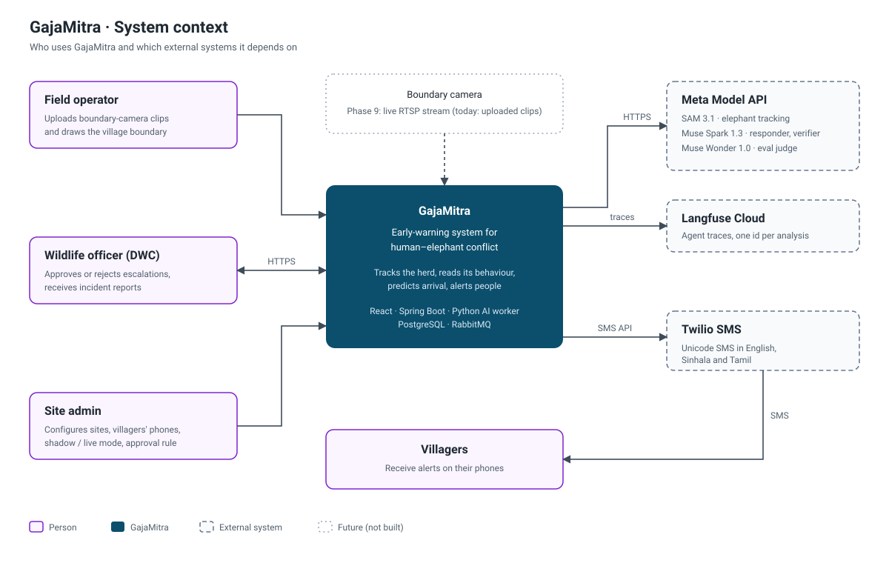
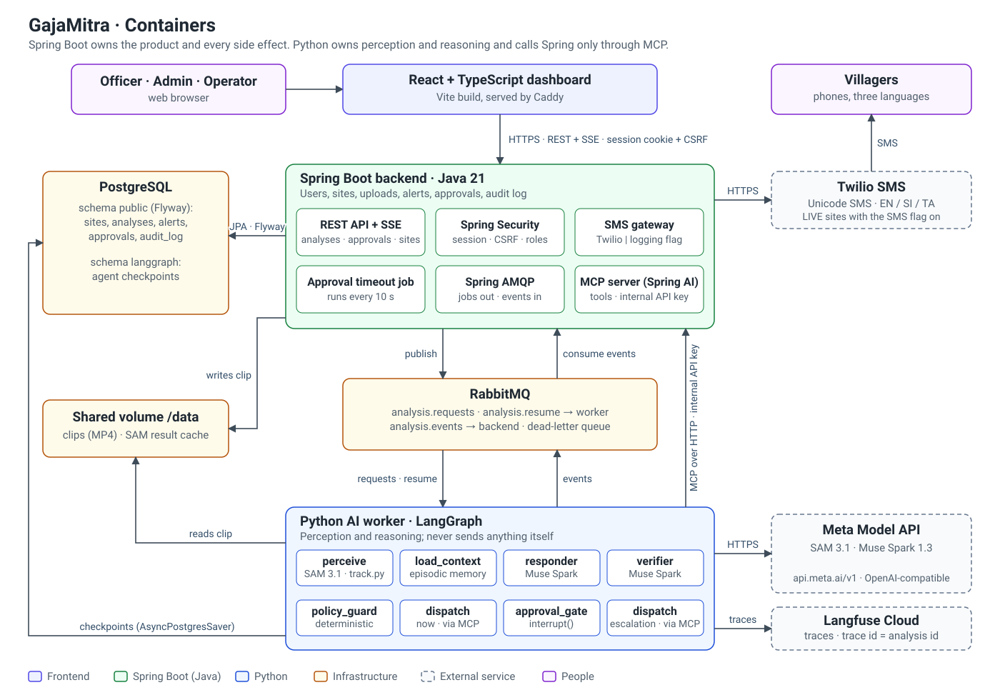
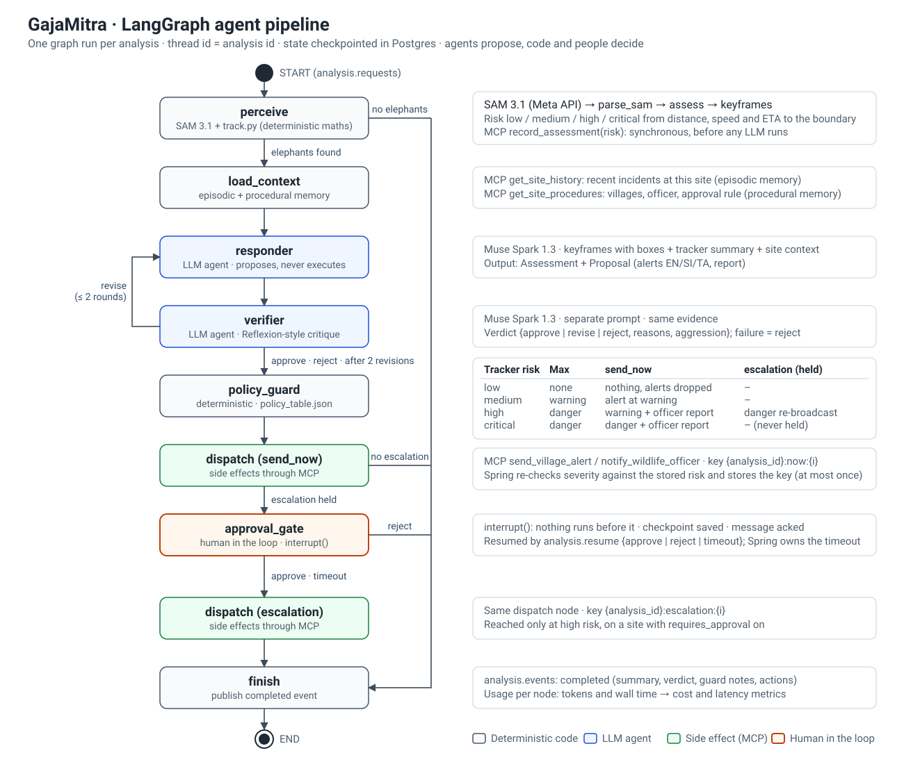
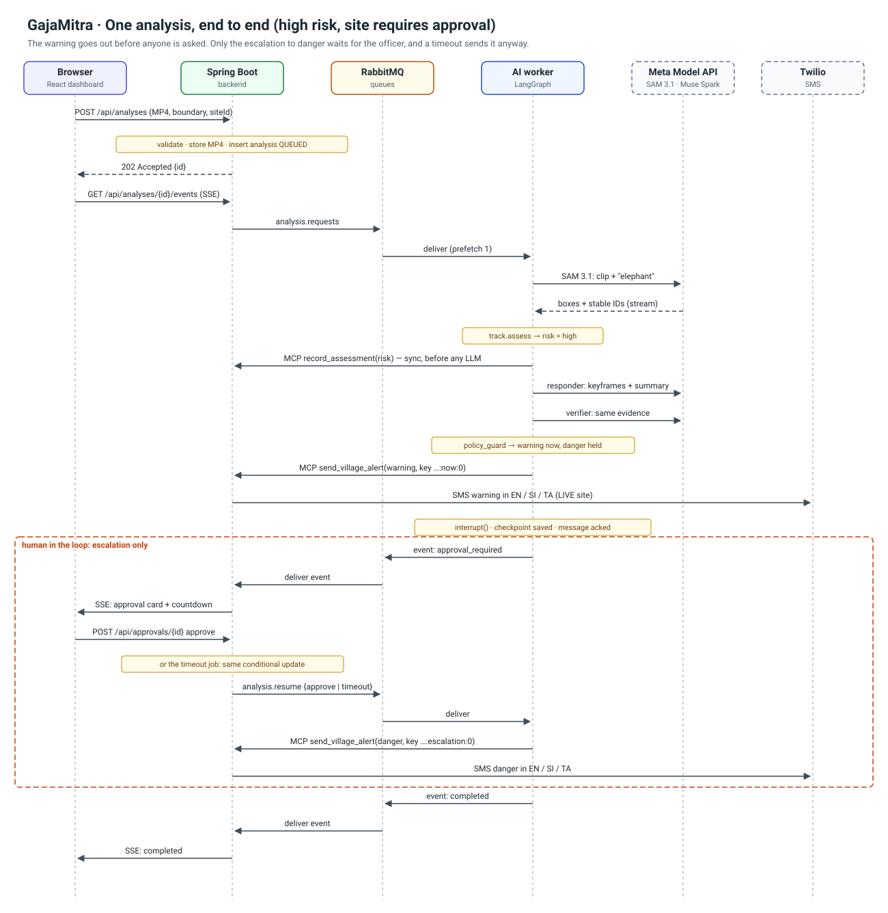
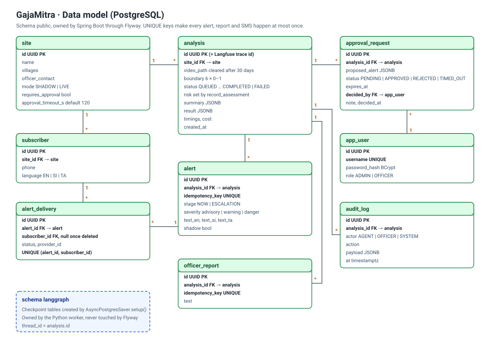
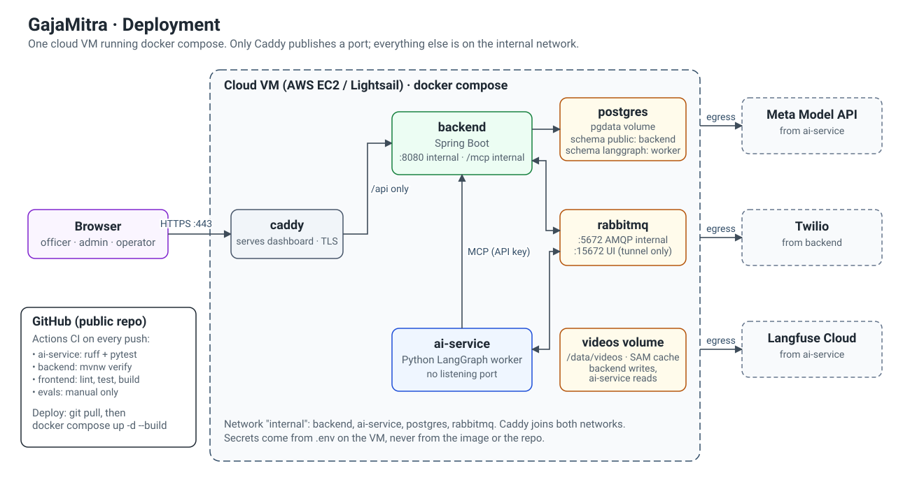
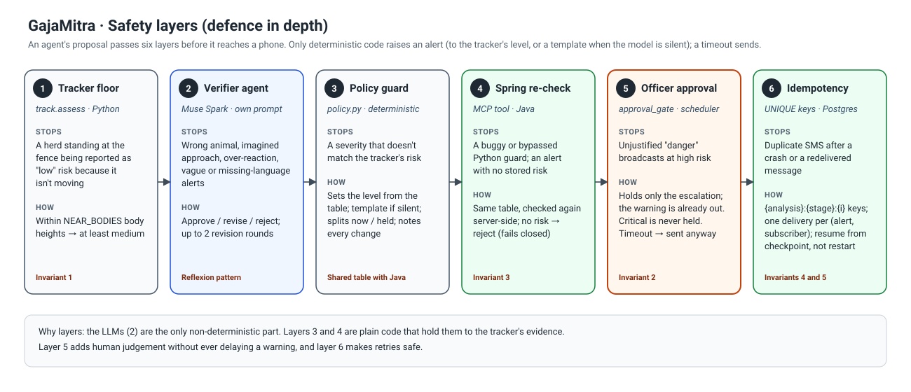

# GajaMitra architecture

GajaMitra watches boundary-camera video for elephants, predicts when a herd will reach a village, and alerts
villagers by SMS in Sinhala, Tamil and English. Meta's SAM 3.1 tracks the elephants, and two Muse Spark agents
decide how to respond. Plain code and a wildlife officer check every decision before an SMS goes out.

The build order is in [IMPLEMENTATION_PLAN.md](IMPLEMENTATION_PLAN.md). This page shows the target system.

## 1. System context
Who uses the system and what it depends on.



## 2. Containers
Spring Boot owns the product: users, sites, uploads, alerts, approvals and the audit log. It is also the only
component that performs side effects. The Python worker owns perception and reasoning. The two never call each
other's databases: jobs and events go through RabbitMQ, and the worker calls Spring only through MCP tools.



## 3. Agent pipeline
One LangGraph run per analysis. The agents only *propose*. A deterministic guard sets their proposal to the level the
tracker's evidence allows (and fills in a template if they stay silent), and a human approves escalations.



## 4. One analysis, end to end
The warning goes out before anyone is asked. Only the escalation to "danger" waits for the officer, and a timeout
sends it anyway.



## 5. Data model
UNIQUE idempotency keys make every alert, officer report and SMS happen at most once, even after crashes and
redelivered messages.



## 6. Deployment
One VM running docker compose. Only Caddy publishes a port.



## 7. Safety layers
Six layers sit between an agent's proposal and a villager's phone.



## Key decisions

| Decision | Why | Trade-off accepted |
|---|---|---|
| Spring Boot (Java) for the product, Python for AI | Each language does what its ecosystem is best at: Spring for security, transactions, scheduling and messaging; Python for SAM, OpenCV and LangGraph | Two codebases and an internal contract between them |
| RabbitMQ between the services | An analysis takes minutes, so it can't be an HTTP request. Queues survive restarts and give retries and a dead-letter queue | One more piece of infrastructure |
| Side effects only through Spring's MCP tools | One place enforces policy, idempotency, shadow mode and the audit log. The agent gets least privilege | An extra network hop per action |
| Agents propose; code and people decide | LLMs are the only non-deterministic part, so they never act directly | More nodes in the graph |
| One `policy_table.json` read by Python and Java | The two guardrails can't drift apart | A shared file across two codebases |
| Human approval only for escalations, with a timeout that sends | A busy officer must never delay a warning about a herd at the fence | An unapproved "danger" can go out after the timeout |
| LangGraph checkpoints in Postgres | Interrupt and resume across process restarts without a second database | The worker needs database access (its own schema) |
| SSE instead of WebSockets | Updates only flow server → browser; SSE works over plain HTTP with the session cookie | No browser → server messages on that channel (REST covers them) |
| Session login + CSRF instead of JWT | The SPA is served from the same origin, so a cookie session is simpler and safer | Not designed for third-party API clients |
| Langfuse Cloud for traces | Self-hosting Langfuse v3 needs ClickHouse, Redis and S3 | Traces leave the VM |
| One VM with docker compose | Enough for a pilot site; every service already runs in a container | No automatic scaling (Phase 9) |

## Regenerating diagrams
Diagrams 1–3 and 6–7 are hand-written SVG. Diagrams 4 and 5 are generated; edit the script, then run it from the
repo root:

```powershell
python docs/architecture/src/gen_sequence.py
python docs/architecture/src/gen_erd.py
```
